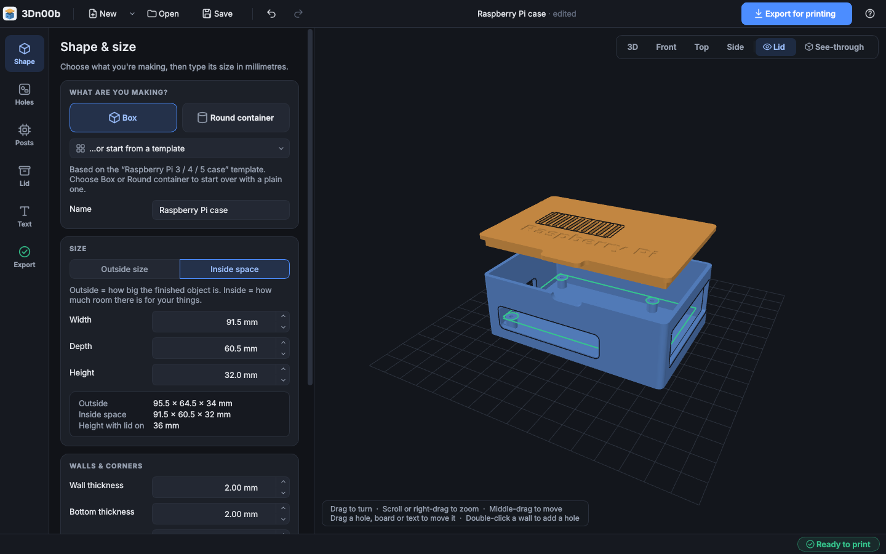

# 3Dn00b

Software for people getting into 3D printing and want to start with something easier than CAD software. The goal is to have everyone interested in starting 3D printing in focus, not advanced designers. The program is vibe-coded, so if that's not you thing you can look elsewhere.



**3Dn00b is deliberately *not* a CAD program.** You pick a shape, type the
sizes in millimetres, add holes and a lid, and export files your slicer can
print. No sketches, no constraints, no feature trees.

## What it can do (version 0.1)

- **Box** (with rounded corners) or **round container**.
- Sizes as **outside size** or **inside space**, with a single switch.
  The other measurement is always shown.
- Wall and bottom thickness.
- **Round holes** on any wall, the bottom or the lid. Double-click a wall
  in the 3D view to put a hole there, or use **Add hole**. **Drag a hole** to
  move it: it slides along its own wall, snaps to the centre lines and lines up
  with other holes, and always keeps a safe distance from the edges. Common
  sizes are built in (M3/M4 screws, cables).
- A **push-on lid** with a lip and a Tight / Normal / Loose fit (or a custom
  gap). It resizes itself with the box.
- **Checks in plain language**, for example a hole running off the edge of a
  wall, a hole hidden behind the lid's lip, holes that overlap, walls that are
  too thin, or a lid that won't fit. Many come with a one-click **Fix** that
  you can undo.
- **Undo / redo** for every change.
- **Save and reopen** editable projects (`.3dn00b` files, plain JSON).
- **Export STL** files: one per printable part, flat side down and ready for
  your slicer (the lid comes out upside down, which is how it prints best).
  Every exported part is guaranteed to be watertight.

## Install and run (Linux)

You need Python 3.10 or newer and a working OpenGL driver (any normal
desktop, including integrated graphics).

First install the system packages Qt needs to open a window:

```bash
sudo apt install python3-venv libxcb-cursor0     # Debian / Ubuntu / Mint
sudo dnf install xcb-util-cursor                 # Fedora
sudo pacman -S xcb-util-cursor                   # Arch / Manjaro
```

Then:

```bash
git clone https://github.com/githak/3Dn00b.git
cd 3Dn00b
python3 -m venv .venv
.venv/bin/pip install -e .
.venv/bin/3dn00b                      # or: .venv/bin/3dn00b examples/screw-box.3dn00b
```

To get a menu entry, copy `data/3dn00b.desktop` to `~/.local/share/applications/`
and make sure `3dn00b` is on your `PATH` (for example by symlinking
`.venv/bin/3dn00b` into `~/.local/bin/`).

## How to use it

1. **Shape**: choose Box or Round container and type the sizes.
2. **Holes**: click **Add hole** (or double-click a wall in the 3D view), then
   pick where it goes, how big it is and where on that surface it sits. Positions
   are measured from the middle of the surface, so `0` means centred.
3. **Lid**: tick **Add a lid** and choose a fit.
4. **Check & Export**: read the checks, fix anything marked ✖ and click
   **Export for printing**.

In the 3D view: drag a hole to move it, drag anywhere else to turn the view,
scroll or right-drag to zoom, middle-drag to pan, and double-click a wall to
add a hole. Each drag is one step for Undo.

## Examples

The `examples/` folder has a screw box, a pencil cup and a small sensor
enclosure with air holes in the lid.

## Development

```bash
.venv/bin/pip install -e ".[test]"
.venv/bin/python -m pytest              # core tests
xvfb-run -a .venv/bin/python -m pytest  # also runs the GUI tests without a screen
```

If PrusaSlicer is installed (`sudo apt install prusa-slicer`), the tests also
slice every example to G-code to make sure the exported files work in a real
slicer.

The code is split so each part can be tested on its own:

| Module | Job |
| --- | --- |
| `threedn00b/model.py` | The editable design: shape, sizes, holes, lid, and the rules for where holes can go |
| `threedn00b/geometry.py` | Turns the design into solid parts (via [Manifold](https://github.com/elalish/manifold)) |
| `threedn00b/validation.py` | Plain-language checks and suggested fixes |
| `threedn00b/project_io.py` | Project files (versioned JSON) and STL export |
| `threedn00b/picking.py` | Works out which wall or hole is under the mouse, and where a dragged hole goes |
| `threedn00b/gui/` | The Qt (PySide6) window and the 3D preview (pyqtgraph) |

See [docs/PRODUCT.md](docs/PRODUCT.md) for the product scope, the decisions
behind it and what is planned next.

## License

GPL-3.0. See [LICENSE](LICENSE).
